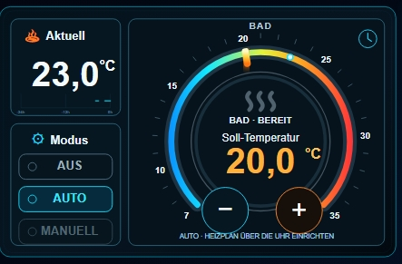
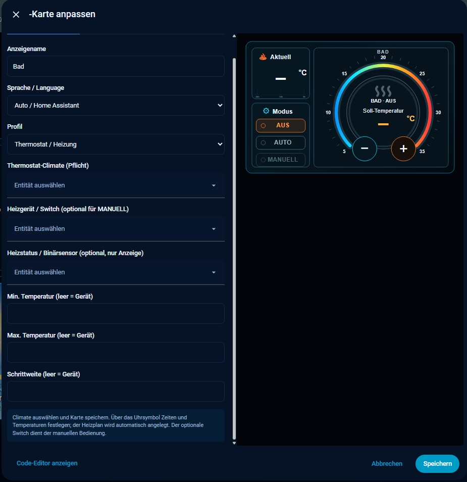

# Frankys_Stuff Climate Card — Standalone v0.2.6 (HACS ready)

<p align="center">
  <a href="https://ko-fi.com/Frankys_Stuff">
    
  </a>
</p>

[](https://hacs.xyz/docs/faq/custom_repositories/)


A local Home Assistant Lovelace climate control card with a responsive HUD-style dial, current/target temperatures, operating modes, optional schedule editor, and touch interaction.

## Vorschau / Preview

### Climate Card



### Visueller Karteneditor / Visual card editor



## Download

[frankys-stuff-climate-card.js](frankys-stuff-climate-card.js) — standalone JavaScript, no other runtime assets required.

**Installation:** Manuell oder über HACS als benutzerdefiniertes Dashboard-Repository. Die Karte benötigt keine zusätzlichen JavaScript-Bibliotheken.

**Aktueller Stand / Current status:** v0.2.5 liegt im Hauptzweig und enthält die geprüfte HACS-Konfiguration. **Letztes veröffentlichtes GitHub-Release:** [v0.2.5](https://github.com/Franz1302/frankys-stuff-climate-card/releases/tag/v0.2.5). **Lizenz:** MIT (`LICENSE`, `LICENSE_SCOPE.md`).

**Features**
- Profiles: `thermostat`, `pool_heatpump`, `advanced`
- Target temperature via touch/click on the circular dial, drag, or +/- buttons
- Operating modes OFF / AUTO / MANUAL, depending on the configured profile
- Optional Home Assistant schedule editor for weekday (Mon–Fri) and weekend (Sat–Sun) blocks
- Complete German/English labels for both the card and its visual editor, automatic Home Assistant language selection or manual override
- Local implementation: no CDN, separate assets, cloud service, API key, external fonts, or third-party JavaScript library
- HA GUI card editor; old `jarvis-*` element aliases remain for compatibility
- **24-hour temperature trend** in the original current-temperature panel, with time-proportional positions. Loads real Home Assistant Recorder values after reload, syncs history at most once per 15 minutes, and does not invent values for unavailable intervals.
- Optional **read-only** `heating_status_entity` (`binary_sensor`) for a measured heating state in thermostat mode. Display-only: it is not a switch and receives no service calls.
- Current temperature scale and subtle line-graph refinements from the active card; existing touchscreen dial, modes and schedule controls retained.

## Sprache / Language

- **Automatisch / Automatic (`language: auto`):** Nutzt die Home-Assistant-Sprache (`de` → Deutsch, `en` → English; andere Sprachen → English).
- **Manuelle Auswahl / Manual selection:** `language: de` oder `language: en`.
- Kartenansicht, visueller Editor, Hinweise und bekannte Heizplan-Fehlermeldungen wechseln mit der gewählten Sprache.
- **Keine separaten Sprachdateien erforderlich / No separate translation assets required.** Everything is included in the standalone JavaScript.
- The v0.2.4 translation release passed syntax and language-switching tests. Version v0.2.5 adds HACS support; the HACS-managed resource has been observed in a Home Assistant installation, without an additional full functional test.


## HACS (benutzerdefiniertes Repository / custom repository)

**Status (2026-10-18):** The repository includes `hacs.json` and a passing automated HACS validation (8/8 checks). Release **v0.2.5** is published, and the HACS-managed JavaScript resource is registered in Home Assistant. A separate end-to-end functional installation test has not been documented. **This card is not listed in the official HACS catalogue**; add it as a custom Dashboard repository.

1. Öffne **HACS → ⋮ → Benutzerdefinierte Repositories / Custom repositories**.
2. Füge `https://github.com/Franz1302/frankys-stuff-climate-card` hinzu.
3. Wähle den Typ **Dashboard** (HACS-Backend-Kategorie: `plugin`) und bestätige.
4. Die Karte in HACS herunterladen (aktuell veröffentlichtes Release: **v0.2.5**).
5. Die JavaScript-Modul-Ressource lautet bei HACS-Installation gewöhnlich:
   `/hacsfiles/frankys-stuff-climate-card/frankys-stuff-climate-card.js`.
   Prüfe unter **Einstellungen → Dashboards → Ressourcen**, ob HACS sie bereits eingetragen hat. Nicht doppelt registrieren.

**Existing manual installations / Bestehende manuelle Installationen:** Do not load both the manual `/local/...` JavaScript and the HACS `/hacsfiles/...` JavaScript on the same Home Assistant frontend. Keep an existing working manual resource unchanged unless you intentionally migrate to HACS, then switch resource registrations carefully. All previous `custom:jarvis-climate-card` aliases remain in the script.

## English: installation

1. Copy **`frankys-stuff-climate-card.js`** to `/config/www/frankys-stuff/climate/` on your Home Assistant installation. Create these folders if necessary.
2. In Home Assistant, open **Settings → Dashboards → Resources** (the exact UI position may vary by version). Add:
   - **URL:** `/local/frankys-stuff/climate/frankys-stuff-climate-card.js?v=0.2.6`
   - **Type:** `JavaScript module` (`module`)
3. Reload the browser. Add a new card using the visual editor or this YAML:

```yaml
type: custom:frankys-stuff-climate-card
name: Living room
profile: thermostat
display_entity: climate.living_room
```

Replace `climate.living_room` with **your own entity**.

Example for a thermostat with a **separately measured heating state**:

```yaml
type: custom:frankys-stuff-climate-card
name: Bathroom
profile: thermostat
display_entity: climate.bathroom
heating_status_entity: binary_sensor.bathroom_heating_active
```

The `binary_sensor` may come from Home Assistant's built-in Threshold helper fed by a suitable power meter. Calibrate its threshold to the actual standby and heating power of the appliance. This configuration **never switches the measuring plug**. Leave `heater_entity` empty unless a deliberate manual-switch control is wanted.

Example for a climate-based heat pump:

```yaml
type: custom:frankys-stuff-climate-card
name: Heat pump
profile: pool_heatpump
display_entity: climate.pool_heat_pump
control_entity: climate.pool_heat_pump
```

Optional profile-specific configuration keys: `language` (`auto`, `de`, `en`), `min_temp`, `max_temp`, `step`, `heater_entity` (thermostat manual override), `heating_status_entity` (thermostat activity display only); `target_entity` (`input_number` or `number`), `temperature_entity`, `mode_entity`, `off_script`, `manual_script`, and `schedule_entity` (advanced setups). The graphical editor shows the fields relevant to the selected profile.

**Important operating notes**
- This card sends real Home Assistant service calls and can change heating device states.
- In the `thermostat` profile, selecting MANUAL stops the climate controller; when a `heater_entity` is configured, tapping the heat waves can directly toggle the associated switch. Use only with suitable control/safety logic.
- **AUTO mode in the `thermostat` profile (v0.2.6):** new optional key `auto_hvac_mode` (`heat` = default, `auto`), selectable in the editor as "AUTO operating mode". The editor offers only modes reported in `hvac_modes` by the climate entity. Use `auto` for thermostats with their own automatic program (e.g. Homematic). If the chosen mode is not supported but the other one is, the supported one is sent; without `hvac_modes` the configured mode is sent; if neither `heat` nor `auto` is supported, no service call is sent and the card shows "AUTO NOT SUPPORTED". OFF, MANUAL and the `pool_heatpump`/`advanced` profiles are unchanged.
- **Compatibility (v0.2.6):** existing configurations need no change; without `auto_hvac_mode` AUTO sends `heat` exactly as before. Only if the entity does not support `heat` but supports `auto`, `auto` is now sent instead of an invalid `heat`. Setting `auto` can hand control to the device's own schedule, which may override the setpoint set via the card; test it with your device.
- `heater_entity` **is a switch for control**. `heating_status_entity` **is a binary sensor for display only**. Never put a measuring plug into `heater_entity` merely to observe its load.
- With the optional measured state configured: `on` → **ACTIVE**, `off` → **READY** (while climate remains enabled) or **OFF** (when climate is off), `unavailable`/`unknown` → **UNAVAILABLE**. Without a configured heating status, the previous visual status logic is retained.
- The 24-hour graph requires Home Assistant's **Recorder** to retain the source entity and a working Lovelace History WebSocket API. If Recorder is disabled/excludes the source, only readings observed while the card is open can be shown; reloading never generates fake readings.
- Editing/saving schedules requires an administrator account. The built-in editor expects continuous weekday/weekend time blocks, with 5–30 °C setpoints at 0.5 °C intervals. Other schedules may be intentionally refused rather than overwritten.
- Card and visual configuration editor support German and English, including explanatory hints and known schedule validation messages. Selection via `language: auto`, `de`, or `en`; unsupported HA locales fall back to English.
- Old Safari/iOS browsers may operate the card but struggle with the general Home Assistant dashboard edit interface. Configure the card in a modern desktop browser if necessary.
- Time formatting prefers the time zone configured in Home Assistant; when unavailable, this version falls back to `Europe/Vienna`.
- Custom element aliases `custom:jarvis-climate-card` and `custom:jarvis-climate-card-legacy` are included only to support existing setups. For new installations use `custom:frankys-stuff-climate-card`.
- If changes do not appear, change the `?v=` resource suffix and reload the browser. Do not register multiple copies of this script under different URLs on the same HA frontend.

## Deutsch: Installation

1. Die Datei **`frankys-stuff-climate-card.js`** nach `/config/www/frankys-stuff/climate/` kopieren (Ordner bei Bedarf anlegen).
2. In Home Assistant unter **Einstellungen → Dashboards → Ressourcen** folgende Ressource registrieren:
   - **URL:** `/local/frankys-stuff/climate/frankys-stuff-climate-card.js?v=0.2.6`
   - **Typ:** `JavaScript-Modul` (`module`)
3. Browser neu laden und diese Karte hinzufügen:

```yaml
type: custom:frankys-stuff-climate-card
name: Wohnzimmer
profile: thermostat
display_entity: climate.wohnzimmer
```

`climate.wohnzimmer` ist nur ein **Beispiel**. Eigene Climate-Entität auswählen.

**Beispiel: nur lesender Heizstatus durch Leistungsmessung**

```yaml
type: custom:frankys-stuff-climate-card
name: Bad
profile: thermostat
display_entity: climate.bad
heating_status_entity: binary_sensor.badezimmer_heizt
```

`heating_status_entity` nutzt einen Binärsensor ausschließlich zur **Anzeige**. `on` bedeutet „heizt“, `off` bedeutet „heizt nicht“. Bei eingeschaltetem Thermostat erscheint dann **AKTIV** bzw. **BEREIT**; bei fehlenden Sensordaten **NICHT VERFÜGBAR**. Der unabhängig davon bestehende `heater_entity`-Switch bleibt allein für die manuelle Steuerung und darf nicht als Messsensor missbraucht werden.

Die kleine Temperaturkurve zeigt **24 Stunden echte Recorder-Daten** auf einer Zeitachse und lädt sie nach einem Seitenneustart erneut. Messausfälle werden als Unterbrechungen dargestellt. Die Home-Assistant-Recorder-Aufzeichnung des gewählten Climate-/Temperatursensors muss aktiv sein.

**Wichtige Hinweise**
- `thermostat` (ab v0.2.6): Neue optionale Einstellung `auto_hvac_mode` (`heat` = Standard, `auto`), im Editor unter „AUTO-Betriebsmodus“. Angeboten werden nur Modi, die die Climate-Entität in `hvac_modes` meldet. `auto` ist für Thermostate mit eigenem Automatikprogramm gedacht (z. B. Homematic). Wird der gewählte Modus nicht unterstützt, der andere aber schon, wird dieser gesendet; ohne `hvac_modes` der eingestellte Modus. Unterstützt die Entität weder `heat` noch `auto`, wird kein Befehl gesendet und „AUTO NICHT UNTERSTÜTZT“ angezeigt. **Kompatibilität:** Bestehende Konfigurationen bleiben unverändert (Standard `heat`). Mit `auto` kann das geräteeigene Zeitprogramm die Solltemperatur der Karte übersteuern; am eigenen Gerät testen.
- `thermostat`: Die Climate-Entität übernimmt die Regelung. Ein optionaler `heater_entity`-Switch ermöglicht die manuelle Direktbedienung. Die MANUELL-Funktion kann den Climate-Regler abschalten und den Switch direkt schalten.
- `pool_heatpump`: Zur Steuerung einer passenden Climate-Entität. Bestehende PV-/Energie-Automationen müssen vom Anwender selbst passend konfiguriert werden.
- `advanced`: Für zusätzliche Sensoren, Helper, Skripte und individuelle Steuerlogik.
- Der Heizplaneditor wird über das Uhrsymbol geöffnet. Speichern erfordert HA-Administratorrechte; unterstützt sind Wochen- und Wochenendgruppen mit zusammenhängenden Zeitblöcken.
- Das Bearbeiten von Dashboards im alten Safari (z. B. iOS 12) kann träge sein. Für Konfigurationsänderungen wird ein aktueller PC-Browser empfohlen.
- Bei Cacheproblemen die Versionskennung der Ressource erhöhen und Browser neu laden.
- Für neue Dashboards bitte ausschließlich `custom:frankys-stuff-climate-card` verwenden.
- Die Kaffeekassa ist freiwillig, die Karte bleibt kostenlos: [Ko-fi](https://ko-fi.com/Frankys_Stuff).

## Tests / Tests performed

- Active Home Assistant dashboard and legacy aliases: PASS (user-confirmed)
- Touch interactions on older room tablets: PASS (user-confirmed)
- OFF/AUTO/MANUAL modes and schedule: PASS (user-confirmed on their setup)
- Visual card editor on Windows PC: PASS (user-confirmed)
- Static JavaScript syntax, alias registration and editor-update regression checks: PASS
- v0.2.6 AUTO mode selection with simulated entities (`node tests/auto-mode.test.js`): PASS; real Homematic hardware: NOT YET TESTED
- Dashboard editing in legacy Safari: LIMITED by general HA/browser performance, not established as a card defect
- Independent device/browser matrix: NOT YET COMPLETED

## Publication and license

**Software and documentation:** MIT License (`LICENSE`). Copying, editing, commercial use and redistribution are permitted under the license conditions. Preserve the complete copyright and license notice.

**License scope:** `LICENSE_SCOPE.md`. This release contains no separate bundled weather artwork or other CC BY-NC 4.0 media. Third-party information: `THIRD_PARTY_NOTICES.md`.

**Copyright (c) 2026 Frankys_Stuff.** See `QA_REPORT.md` and `RELEASE_STATUS.md` for the reviewed release scope and limitations.

## Changelog

**v0.2.6 (draft, unpublished)**
- Thermostat profile: new optional `auto_hvac_mode` (`heat` default / `auto`) with editor selection offering only supported modes (DE/EN); `auto` fixes Homematic. Default keeps the legacy `heat`; no invalid service call and a visible error if neither mode is supported.
- OFF, MANUAL, `pool_heatpump` and `advanced` unchanged. Regression tests: `node tests/auto-mode.test.js`.
- Compatibility: existing configurations unchanged; `auto` is opt-in (see operating notes).

**v0.2.5 (2026-10-11, HACS release published)**
- HACS plugin manifest `hacs.json` and automatic validation workflow available.
- GitHub description, HACS topics and screenshots configured; automated HACS validation passed 8/8 checks before packaging.
- JavaScript card code unchanged except version marker, including the DE/EN translation system and control behavior.
- GitHub v0.2.5 release published; HACS-managed frontend resource has since been verified as registered in Home Assistant.

**v0.2.4 (2026-10-11, published release)**
- Completed German/English translation of the visual editor, profile options, hints and known heating schedule validation messages.
- Auto language follows Home Assistant; manual `de` or `en` override updates the editor without changing heater controls.
- No extra translation resource. The existing v0.2.3 GitHub tag remains unchanged.


**v0.2.3 (2026-10-11)**
- Übernahme der aktuellen grafischen Temperatur-/Skalenverbesserungen in die öffentliche Standalone-Datei.
- Echte, zeitbasierte **24-Stunden-Temperaturkurve** mit Wiederherstellung aus Home Assistant Recorder nach Aktualisierung, periodischer Historienabfrage und Unterbrechungen bei Messausfällen.
- Neues optionales, rein lesendes Feld `heating_status_entity` für Thermostatkarten einschließlich Auswahl im Karteneditor: **AKTIV / BEREIT / AUS**.
- Bestehende Bedienelemente, Heizplan und Steuerbefehle nicht geändert.
- Die neuen Funktionen (24-Stunden-Kurve und Heizstatus) wurden am 11.10.2026 vom Herausgeber in Home Assistant überprüft und als funktionierend bestätigt. Unabhängige Tests auf weiteren Geräten stehen aus.


**v0.2.2 (2026-10-11)**
- Stabilized touch/drag handling with tap tolerance and an older-WebKit fallback.
- Optimistic target temperature display pending Home Assistant state updates.
- Maintained automatic language support and embedded display mode.
- Added public `frankys-stuff-climate-card` element plus legacy aliases.
- Reduced unnecessary entity-picker updates and duplicate config-changed events.
- Improved escaping of dynamic card text.
- No changes to the active heating modes or schedule logic in this documentation pass.
